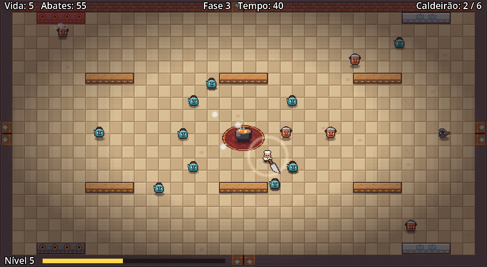

# Panelas Malditas

Jogo de horda feito na Godot 4.7 para o projeto do 2º bimestre de Jogos Digitais II (UNIGRAN, 2026/2, Prof. Ezéfferth C. A. Fernandes).

Matheus Nunes De Paula

## A carta

| Parte da carta | O que saiu |
| --- | --- |
| Tema | Cozinha de restaurante com panelas rebeldes |
| Tipo de jogo | **Defesa**: proteger por 3 minutos um objeto fixo, que aguenta 5 toques de inimigo |
| Modo | **Horda** (arena vista de cima, movimento nas quatro direções) |

**A ideia:** você é o chef, e as panelas da cozinha se rebelaram. Elas entram pelas quatro portas atrás do caldeirão de sopa, que fica no centro da cozinha. Se o caldeirão levar 5 pancadas, a sopa está perdida. Aguente 3 minutos e o serviço está salvo.

## Como jogar

| Tecla | Ação |
| --- | --- |
| Setas ou W A S D | andar |
| 1, 2, 3 ou o mouse | escolher a melhoria ao subir de nível |
| Enter | começar, na tela de início, e jogar de novo, na tela de fim |
| Esc | pausar o jogo e abrir o livro de receitas (e continuar); na tela de fim, voltar para a tela de início |
| setas ou A / D | no livro de receitas, virar a página |
| M | na pausa, voltar para a tela de início |

As panelas entram pelas quatro portas ou pulam dos fogões e das pias (que piscam em vermelho 1 s antes) e vão atrás do caldeirão. Há quatro tipos:

| Panela | O que faz |
| --- | --- |
| comum | vai atrás do caldeirão |
| frigideira | mais rápida |
| panela de pressão | mais lenta, aguenta 3 golpes |
| panela brava | vermelha, vai atrás do chef e não do caldeirão |
| chaleira | para longe do caldeirão e cospe vapor nele; o vapor tira um toque, a não ser que o chef entre na frente |
| Panelão | a panela gigante: chega aos 2:15 pela porta de cima, é lenta, aguenta 50 golpes, vale 25 XP e, se chegar ao caldeirão, fica batendo nele a cada 1,5 s até ser derrubada |

Cada panela que encosta no caldeirão é um toque, e no 5º toque você perde. O chef ataca sozinho: a faca dá uma volta em torno dele a cada 0,4 s e derruba as panelas que estiverem perto. Vá até elas antes que cheguem ao caldeirão. Encostar no chef também tira 1 de vida, e sem vida você perde. Aguente 3 minutos e você vence.

O chef não consegue subir no caldeirão, só ficar do lado dele. Cada panela derrubada solta bolinhas verdes de XP no chão (a de pressão e a chaleira soltam 3, a brava 2, o Panelão 25 e as outras 1). Quando o chef passa perto (48 px), as bolinhas voam até ele e viram XP. Com XP suficiente o chef sobe de nível, o jogo pausa e mostra três cartões sorteados, cada um com o desenho e o nome da melhoria:

| Melhoria | O que faz |
| --- | --- |
| Faca maior | alcance +4 (até 40) |
| Golpe rápido | recarga 15% menor (até 0,3 s) |
| Faca afiada | dano +1 |
| Botas | chef 15% mais rápido |
| Vida +1 | vida +1 |
| Caldeirão +1 | o caldeirão aguenta +1 toque |

Além das melhorias, o sorteio oferece armas novas (o cartão diz "NOVA"). Cada arma, depois de escolhida, também aparece no sorteio para subir de nível, até o 5 (o cartão diz "Nv 2", "Nv 3"...):

| Arma | Como funciona |
| --- | --- |
| Faca (a do começo) | gira em volta do chef e acerta quem estiver perto |
| Panelaço | o chef bate uma tampa e solta uma onda para todos os lados, que acerta e empurra as panelas |
| Garfos | arremessa garfos nas panelas mais perto; o garfo atravessa panelas e para na parede |
| Colheres | colheres que giram longe do chef o tempo todo, por fora da faca e no sentido contrário |
| Pote de mel | joga uma poça de mel perto das panelas, que gruda, machuca e deixa quem pisa mais lento |

O primeiro nível pede 5 XP, e cada nível seguinte pede 5 a mais (10, 15, 20...).

A cada 12 s aparece um power-up num lugar sorteado do chão (no máximo 3 ao mesmo tempo). As panelas também soltam power-ups quando quebram: a comum e a frigideira em 4% das vezes, a brava em 8%, a de pressão e a chaleira em 12%, e o Panelão sempre solta dois (no máximo 5 no chão). O power-up pisca nos últimos 3 s e some depois de 15 s:

| Power-up | Efeito |
| --- | --- |
| Ímã | puxa todas as bolinhas de XP da cozinha até o chef |
| Pimenta | chef 60% mais rápido por 8 s |
| Coxinha | vida +1 (só aparece quando o chef está machucado) |
| Gelo | congela todas as panelas por 4 s |
| Tampa | o caldeirão não leva toque por 6 s |

Os 3 minutos têm três fases:

| Fase | Tempo | O que muda |
| --- | --- | --- |
| 1 | 0 a 1 min | só panelas comuns, entrando pelas portas |
| 2 | 1 a 2 min | os fogões e as pias começam a soltar panelas, e entram a frigideira e a chaleira |
| 3 | 2 a 3 min | chegam também a panela de pressão e a brava, e as panelas vêm mais duras (a comum aguenta 2 golpes e a de pressão 5) |

## Andamento

| Tag | O que o jogo tem |
| --- | --- |
| `aula-08` | a cozinha vista de cima (40 × 22 peças, cabe numa tela), com parede, portas, fogões, pias e bancadas com colisão, e o chef andando nas quatro direções |
| `aula-09` | panelas que nascem nas portas e perseguem o chef, horda que aperta com o tempo, vida com invencibilidade, placar e telas de vitória e derrota |
| depois da `aula-09` | ficha Defesa: o caldeirão que aguenta 5 toques, as panelas indo atrás dele, o ataque do chef e os 3 minutos |
| `aula-10` | navegação: as panelas acham o caminho pela cozinha (recalculado 5 vezes por segundo) e contornam as bancadas, então o caldeirão apanha pelas quatro portas; o ataque do chef com recarga e placar de abates, com uma faca que dá uma volta em torno dele |
| depois da `aula-10` | panelas pulando também dos fogões e das pias, com aviso piscando antes, quatro tipos de panela, três fases nos 3 minutos, ataque automático, XP com melhorias, a chaleira, o caldeirão sólido e a arte nova com efeitos |
| depois da `aula-10` | sons e música de fundo |
| depois da `aula-10` | tela de início, tela de fim com o resumo da partida e recorde de abates salvo |
| depois da `aula-10` | o Panelão, a panela gigante dos últimos 45 s, com barra de vida |
| depois da `aula-10` | pausa com Esc, bolinhas de XP com ímã e chamas e água no aviso dos fogões e das pias |
| depois da `aula-10` | quatro armas novas (Panelaço, Garfos, Colheres de pau e Azeite quente), cada uma com 5 níveis |
| depois da `aula-10` | power-ups no chão: ímã, pimenta, coxinha, gelo e concha de sopa |
| depois da `aula-10` | tela de nível com cartões (desenho e nome) e a pausa como um livro de receitas que explica cada item |
| depois da `aula-10` | sem itens repetidos: a Tampa no lugar da concha de sopa, as colheres por fora da faca, o Pote de mel no lugar do azeite e sem o tempero de ímã |

## Créditos

- Arte (piso, paredes, portas, fogões, pias, bancadas, tapete, o chef, a faca, as panelas, a chaleira, o caldeirão e os efeitos): pixel art feita para este projeto.
- Sons e música (no estilo 8 bits): sintetizados para este projeto.
