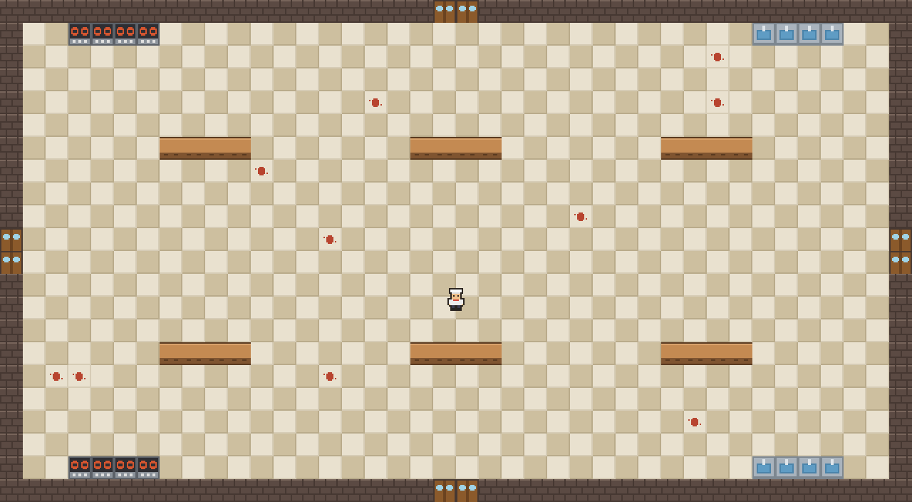

# Panelas Malditas

Jogo de horda feito na Godot 4.7 para o projeto do 2º bimestre de Jogos Digitais II (UNIGRAN, 2026/2, Prof. Ezéfferth C. A. Fernandes).

Matheus Nunes De Paula

## A carta

| Parte da carta | O que saiu |
| --- | --- |
| Tema | Cozinha de restaurante com panelas rebeldes |
| Tipo de jogo | **Defesa**: proteger por 3 minutos um objeto fixo, que aguenta 5 toques de inimigo |
| Modo | **Horda** (arena vista de cima, movimento nas quatro direções) |

**A ideia:** você é o chef, e as panelas da cozinha se rebelaram. Elas entram pelas quatro portas atrás do caldeirão de sopa, que fica no centro da cozinha. Se o caldeirão levar 5 pancadas, a sopa está perdida. Aguente 3 minutos e o serviço está salvo.

## Como jogar

| Tecla | Ação |
| --- | --- |
| Setas ou W A S D | andar |

Por enquanto o jogo é a cozinha com o chef andando. O caldeirão e as panelas entram nas próximas aulas (ver o andamento abaixo).

## Andamento

| Tag | O que o jogo tem |
| --- | --- |
| `aula-08` | a cozinha vista de cima (40 × 22 peças, cabe numa tela), com parede, portas, fogões, pias e bancadas com colisão, e o chef andando nas quatro direções |

## Créditos

- Arte provisória (piso, parede, portas, fogões, pias, bancadas e o chef): feita para este projeto, com auxílio de IA. Ela vai ser trocada pela arte do tema na Aula 11.

## Uso de IA

Feito com a ajuda do Claude Code (assistente de IA da Anthropic), como a seção 6 do projeto permite. Cada script diz, na primeira linha, de onde veio o código (técnica do roteiro da aula ou IA).
